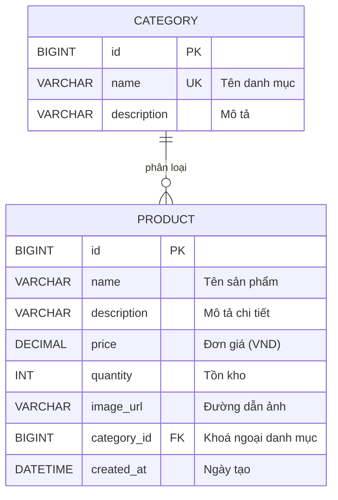

# 🛒 eShop Promax — Spring Boot & Thymeleaf Shopping System


---

## 👨‍💻 Thông Tin Sinh Viên & Đồ Án

* **Họ và tên**: **Vũ Trần Đức Nghĩa**
* **Mã số sinh viên (MSSV)**: `23637711`
* **Học phần**: Phát Triển Ứng Dụng Web / Java Web (Spring Framework)
* **Tên đồ án**: Dự án Shopping Cart eShop với Spring Boot, Spring Data JPA, Thymeleaf & MariaDB
* **Repository**: [`https://github.com/DaMilos35/VuTranDucNghia_23637711_eShop`](https://github.com/DaMilos35/VuTranDucNghia_23637711_eShop)

---

## 🌟 Tổng Quan Dự Án

Dự án **eShop Promax** là ứng dụng thương mại điện tử chuyên nghiệp được xây dựng dựa trên kiến trúc phân tầng chuẩn mực của Spring Boot 3. Toàn bộ giao diện được nâng cấp theo triết lý **Taste Skill (Anti-Slop UI)** và chuẩn mực thiết kế **Hallmark Design System**, mang đến trải nghiệm người dùng cao cấp, hiện đại và logic.

---

## 🚀 Các Tính Năng Đã Triển Khai (Phần 1 & Promax UI/UX)

### 1. Quản Trị Hệ Thống (Admin - CRUD)
* **Quản lý danh mục (`/admin/categories`)**:
  - Xem danh sách danh mục phân loại với thẻ ID và mô tả chi tiết.
  - Thêm mới danh mục có kiểm tra trùng tên (Duplicate Validation).
  - Cập nhật thông tin danh mục.
  - Xoá danh mục an toàn: Ngăn chặn xoá danh mục nếu vẫn còn sản phẩm trực thuộc.
* **Quản lý kho sản phẩm (`/admin/products`)**:
  - Xem danh sách sản phẩm phân trang (10 sp/trang) kèm hình ảnh thu nhỏ, danh mục, đơn giá VND và số lượng tồn kho.
  - Lọc sản phẩm theo danh mục và tìm kiếm theo tên tức thì.
  - Thêm mới sản phẩm với bộ kiểm tra hợp lệ: Tên bắt buộc, đơn giá $\ge 0$, tồn kho $\ge 0$, bắt buộc chọn danh mục.
  - Sửa thông tin sản phẩm: Giữ nguyên an toàn trường `created_at` trong CSDL khi cập nhật.
  - Hộp xem trước hình ảnh trực tiếp (Live Image Preview) ngay trong form.
  - Xoá sản phẩm có xác nhận an toàn (Dialog confirmation).

### 2. Cửa Hàng & Mua Sắm (Customer & Guest)
* **Trang chủ / Danh sách sản phẩm (`/`, `/products`)**:
  - **Hero Banner Promax**: Giới thiệu ưu đãi công nghệ, cam kết 100% chính hãng, miễn phí vận chuyển.
  - **Sidebar danh mục thông minh**: Tự động đánh dấu active và hiển thị biểu tượng điều hướng khi chọn.
  - **Lưới sản phẩm (Grid Card)**:
    - Hiệu ứng nâng thẻ (`hover lift`) và phóng to hình ảnh mượt mà.
    - Nhãn danh mục (Category Tag), giá bán định dạng chuẩn tiền tệ Việt Nam (`₫`).
    - Huy hiệu tình trạng tồn kho tự động: `Còn hàng` (xanh), `Sắp hết` (vàng), `Hết hàng` (đỏ).
    - Bộ xử lý lỗi ảnh tự động (`onerror fallback`) hiển thị ảnh thay thế thanh lịch khi link ảnh ngoài bị gián đoạn.
  - **Phân trang chuẩn mực**: 12 sản phẩm/trang, hỗ trợ nút trang trước/sau và đánh số trang.
* **Trang chi tiết sản phẩm (`/products/{id}`)**:
  - Thanh điều hướng phân cấp (Breadcrumbs): `Trang chủ` › `Danh mục` › `Tên sản phẩm`.
  - Khung ảnh sản phẩm lớn chất lượng cao.
  - Khối thông tin chi tiết: Tình trạng tồn kho, mô tả kỹ thuật, chính sách bảo hành 12 tháng, giao hàng hoả tốc.

### 3. Trung Tâm Trợ Giúp & FAQ Promax (`/help`)
* **Banner Hero kim loại cao cấp**: Chuyển sắc từ xám bạc sang than đậm đúng theo mẫu thiết kế.
* **Bộ lọc danh mục dạng viên thuốc (Filter Pills)**: 7 nhóm chủ đề (`Tất cả`, `Đặt tour`, `Thanh toán`, `Đơn đặt`, `Tìm kiếm AI`, `Thông tin tour`, `Tài khoản`) với hiệu ứng highlight xanh lam tinh tế.
* **Hộp Accordion hỏi đáp tương tác**:
  - Chức năng tìm kiếm trực tiếp (Live Search) tự động mở rộng và lọc câu hỏi khớp với từ khoá.
  - Câu trả lời chi tiết về hướng dẫn đặt hàng/tour, thanh toán trực tuyến, hoàn hủy và mã hoá bảo mật.
* **Trang Điều khoản & Quy định (`/terms`)**: Văn bản pháp lý và quy chuẩn sử dụng dịch vụ minh bạch.

### 4. Hệ Thống Điều Hướng & Footer Promax
* **Header**: Topbar hỗ trợ kỹ thuật `1900 6868`, badge định danh sinh viên, thanh tìm kiếm bo tròn kèm icon kính lúp.
* **Footer 4 cột chuẩn thiết kế**:
  - Đường kẻ chân màu cam rực rỡ (`#ea580c`) dưới tiêu đề Navy đậm (`#1e3a8a`).
  - Mũi tên cam chevron (`›`) với hiệu ứng trượt nhẹ sang phải khi rê chuột.
  - Toàn bộ liên kết đều dẫn đến các tính năng thật và logic trong hệ thống.
  - Nút tròn nổi cố định "Lên đầu trang" (Back to top) hỗ trợ cuộn mượt mà.

---

## 🗄️ Cấu Trúc Cơ Sở Dữ Liệu (MariaDB)

Cơ sở dữ liệu mẫu được lưu tại [`database/eShop.sql`](database/eShop.sql):



Dữ liệu mặc định ban đầu:
* **15 danh mục**: Điện thoại, Laptop, Bàn phím, Chuột, Tai nghe, Loa, Màn hình, Máy ảnh, Phụ kiện sạc, Thiết bị mạng, Thiết bị lưu trữ, Máy in, Gia dụng thông minh, Máy tính bảng, Đồng hồ thông minh.
* **50 sản phẩm**: Đầy đủ các dòng máy Apple, Samsung, Dell, Asus, Sony, Logitech,...

---

## 📂 Cấu Trúc Thư Mục Dự Án

```
VuTranDucNghia_23637711_eShop/
├── build.gradle                          # Cấu hình Gradle, Spring Boot 3.2.12, Lombok
├── settings.gradle                       # Tên root project: VuTranDucNghia_23637711_eShop
├── database/
│   └── eShop.sql                         # Kịch bản khởi tạo CSDL MariaDB mẫu
└── src/
    ├── main/
    │   ├── java/com/example/vutranducnghia_23637711_eshop/
    │   │   ├── EShopApplication.java     # Lớp khởi động Spring Boot
    │   │   ├── entity/                   # Category, Product
    │   │   ├── repository/               # CategoryRepository, ProductRepository
    │   │   ├── service/                  # CategoryService, ProductService
    │   │   ├── controller/
    │   │   │   ├── ShopController.java   # Trang chủ, Chi tiết, Trợ giúp, Điều khoản
    │   │   │   └── admin/
    │   │   │       ├── AdminCategoryController.java
    │   │   │       └── AdminProductController.java
    │   │   └── exception/                # NotFoundException (HTTP 404)
    │   └── resources/
    │       ├── application.properties    # Cấu hình kết nối DB, JPA, server port
    │       ├── static/css/style.css      # Hệ thống CSS Promax (Taste Skill & Hallmark)
    │       └── templates/
    │           ├── fragments/layout.html # Header, Navbar, Footer, Alerts
    │           ├── shop/                 # index.html, detail.html
    │           ├── admin/category/       # list.html, form.html
    │           ├── admin/product/        # list.html, form.html
    │           ├── help/                 # index.html, terms.html
    │           └── error/                # 404.html
    └── test/                             # Unit tests & context loading test
```

---

## 🛠️ Hướng Dẫn Cài Đặt & Chạy Ứng Dụng

### 1. Yêu Cầu Môi Trường
* **JDK**: Java 17 (Eclipse Adoptium Temurin hoặc Oracle JDK 17).
* **MariaDB Server**: Phiên bản 10.6 trở lên (chạy tại cổng mặc định `3306`).
* **Gradle**: Bản đi kèm Gradle Wrapper 8.2.1.

### 2. Khởi Tạo Cơ Sở Dữ Liệu
Chạy tệp SQL trong thư mục `database/`:
```bash
mariadb -u root -p < database/eShop.sql
```
*(Hoặc mở và chạy toàn bộ tệp `eShop.sql` thông qua HeidiSQL / DBeaver / IntelliJ Database tool).*

### 3. Cấu Hình `application.properties`
Chỉnh sửa mật khẩu CSDL cho phù hợp với máy của bạn tại `src/main/resources/application.properties`:
```properties
spring.datasource.url=jdbc:mariadb://localhost:3306/eshop
spring.datasource.username=root
spring.datasource.password=sapassword
```

### 4. Khởi Động Dự Án
Chạy lệnh bằng Gradle Wrapper:
```bash
# Trên Windows (PowerShell / Command Prompt)
.\gradlew.bat bootRun
```
Ứng dụng sẽ khởi chạy tại: 👉 **`http://localhost:8080`**

---

## 📋 Bảng Kiểm Thử Nghiệm Thu (Verification Matrix)

| STT | Chức năng thử nghiệm | Đường dẫn | Kết quả đạt được |
| :---: | :--- | :--- | :--- |
| **1** | Trang chủ cửa hàng | `http://localhost:8080/` | Hiển thị 50 sản phẩm (12 sp/trang), 15 danh mục sidebar, Banner Promax. |
| **2** | Lọc theo danh mục | `http://localhost:8080/products?categoryId=3` | Lọc chính xác 4 sản phẩm Laptop; sidebar highlight active. |
| **3** | Tìm kiếm từ khoá | `http://localhost:8080/products?keyword=samsung` | Trả về đúng 5 sản phẩm của Samsung; có nút "Xoá bộ lọc". |
| **4** | Chi tiết sản phẩm | `http://localhost:8080/products/1` | Breadcrumbs, ảnh phóng to, giá VND, tình trạng kho, chính sách bảo hành. |
| **5** | Trung tâm trợ giúp | `http://localhost:8080/help` | Banner xám kim loại, 7 nút filter pills, Live Search, Accordion đóng mở mượt. |
| **6** | Điều khoản quy định | `http://localhost:8080/terms` | Văn bản điều khoản 5 mục chi tiết, liên kết logic hai chiều. |
| **7** | Thêm danh mục trùng | `POST /admin/categories/save` | Báo lỗi validation đỏ: *"Tên danh mục đã tồn tại"*. |
| **8** | Xoá danh mục đang có hàng | `POST /admin/categories/3/delete` | Ngăn chặn xoá kèm thông báo: *"Danh mục đang có sản phẩm, không thể xoá"*. |
| **9** | Validation thêm sản phẩm | `POST /admin/products/save` | Báo lỗi khi thiếu tên, đơn giá âm, tồn kho âm, chưa chọn danh mục. |
| **10** | Cập nhật sản phẩm | `POST /admin/products/save` | Cập nhật thành công đơn giá/số lượng, bảo toàn nguyên vẹn ngày tạo `created_at`. |
| **11** | Nút footer | Thanh chân trang | 100% nút đều có địa chỉ dẫn chuẩn xác, không có liên kết rỗng. |

---

## 📜 Quy Chuẩn Commit (Conventional Commits)

Dự án áp dụng quy chuẩn đặt tên commit quốc tế:
* `feat(scope)`: Bổ sung tính năng mới.
* `fix(scope)`: Sửa lỗi mã nguồn hoặc logic.
* `style(scope)`: Nâng cấp giao diện UI/UX, CSS, font chữ.
* `docs(scope)`: Cập nhật tài liệu, README, chú thích.
* `refactor(scope)`: Tối ưu hoá cấu trúc code mà không thay đổi chức năng.

---

*Tác quyền © 2026 **Vũ Trần Đức Nghĩa** (MSSV: `23637711`). Đồ án phát triển ứng dụng Web eShop.*
